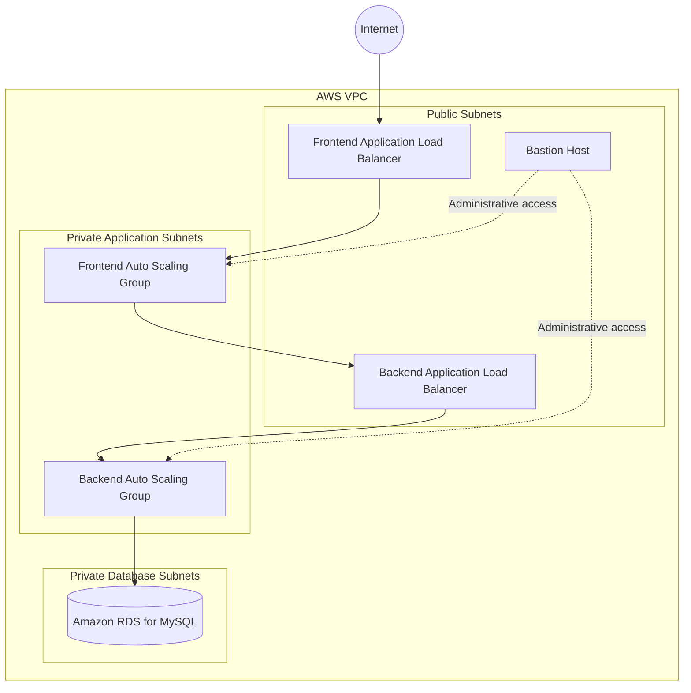

# Modular Three-Tier AWS Infrastructure with Terraform

A modular Infrastructure-as-Code project that provisions the AWS resources for a three-tier application. Terraform modules are used to separate networking, frontend, backend, database, load balancing, and Auto Scaling components.

## Project overview

The configuration includes:

- **Networking:** VPC, public and private subnets across two Availability Zones, route tables, Internet Gateway, and NAT Gateway.
- **Traffic management:** Separate Application Load Balancers for the frontend and backend.
- **Compute:** Frontend and backend EC2 launch templates and Auto Scaling Groups.
- **Database:** A private Amazon RDS for MySQL instance and DB subnet group.
- **Administration:** A bastion host for controlled administrative access.
- **Environments:** Separate Terraform entry points for `dev`, `test`, and `prod`.

## Architecture



> The diagram is a high-level view of the intended traffic flow. Actual access depends on the deployed security-group rules and application configuration.

## Repository structure

```text
Module-Three-Tier-Terraform-Project/
├── README.md
├── Screenshots/
└── Module-Three-Tier-Terraform-Project/
    ├── .gitignore
    └── ROOT/
        ├── envs/
        │   ├── dev/
        │   ├── test/
        │   └── prod/
        └── modules/
            ├── infrastructure/
            ├── bastion/
            ├── frontend/
            │   ├── ec2/
            │   ├── launch-template/
            │   ├── loadbalancer-frontend/
            │   └── asg/
            ├── backend/
            │   ├── ec2/
            │   ├── launch-template/
            │   ├── loadbalancer-backend/
            │   └── asg/
            └── database/
```

## Getting started

### Prerequisites

- Terraform installed
- AWS CLI installed and configured with an AWS account/profile
- AWS permissions to create the resources defined in the modules
- Required key pair and application configuration

### Initialize and review the environment

From the environment you intend to deploy, for example `dev`:

```bash
cd Module-Three-Tier-Terraform-Project/ROOT/envs/dev
terraform init
terraform fmt -recursive
terraform validate
terraform plan
```

Review the plan carefully before applying. If you are using the staged deployment workflow below, run each command from the same environment directory.

### Staged apply workflow

The project’s staged workflow creates the base networking and shared resources first, followed by compute launch templates and Auto Scaling Groups:

```bash
terraform apply -target=module.vpc
terraform apply -target=module.bastion
terraform apply -target=module.frontend-ec2
terraform apply -target=module.backend-ec2
terraform apply -target=module.frontend_alb
terraform apply -target=module.backend_alb
terraform apply -target=module.rds

terraform apply -target=module.frontend_launchtemplate
terraform apply -target=module.backend_launchtemplate
terraform apply -target=module.asg-backend
terraform apply -target=module.asg-frontend
```

Targeted applies are useful for staged troubleshooting/bootstrap work, but they do not replace reviewing a complete plan. After configuration is complete, run `terraform plan` and review all proposed changes before your normal apply.

### Application configuration

1. Configure the frontend to use the backend load balancer URL.
2. Configure the backend with the RDS endpoint and database settings using a secure secret/configuration mechanism.
3. Deploy the frontend and backend application code to the appropriate compute tier.
4. Verify the frontend, backend API, load balancer target health, and database connectivity.

## Screenshots

The images below document the deployment and application workflow. Personal and security-sensitive details identified in the original captures have been redacted in the prepared images.

### Architecture & Networking

<table>
<tr><td align="center" valign="top"><strong>VPC and core network</strong><br></td><td align="center" valign="top"><strong>Public and private subnets</strong><br></td></tr>
<tr><td align="center" valign="top"><strong>Route tables</strong><br></td><td align="center" valign="top"><strong>Security groups</strong><br></td></tr>
</table>

### Compute & Auto Scaling

<table>
<tr><td align="center" valign="top"><strong>AMI created</strong><br></td><td align="center" valign="top"><strong>EC2 servers</strong><br></td></tr>
<tr><td align="center" valign="top"><strong>EC2 key pair configuration</strong><br></td><td align="center" valign="top"><strong>Frontend instance type change</strong><br></td></tr>
<tr><td align="center" valign="top"><strong>Auto Scaling Group created</strong><br></td><td align="center" valign="top"><strong>Auto Scaling Terraform plan</strong><br></td></tr>
<tr><td align="center" valign="top"><strong>Auto Scaling Terraform apply</strong><br></td><td></td></tr>
</table>

### Load Balancing, TLS & DNS

<table>
<tr><td align="center" valign="top"><strong>Application Load Balancers</strong><br></td><td align="center" valign="top"><strong>Backend target group attached</strong><br></td></tr>
<tr><td align="center" valign="top"><strong>Target group and target health</strong><br></td><td align="center" valign="top"><strong>ACM certificate configuration</strong><br></td></tr>
<tr><td align="center" valign="top"><strong>Route 53 hosted zone</strong><br></td><td align="center" valign="top"><strong>Route 53 DNS record</strong><br></td></tr>
<tr><td align="center" valign="top"><strong>Alias record pointing to load balancer</strong><br></td><td align="center" valign="top"><strong>Website accessed through frontend ALB</strong><br></td></tr>
<tr><td align="center" valign="top"><strong>Website accessed through custom domain</strong><br></td><td></td></tr>
</table>

### Database

<table>
<tr><td align="center" valign="top"><strong>Amazon RDS database instance</strong><br></td><td align="center" valign="top"><strong>Backend connectivity to MySQL (connection details redacted)</strong><br></td></tr>
<tr><td align="center" valign="top"><strong>Database tables</strong><br></td><td align="center" valign="top"><strong>Database user table evidence (records redacted)</strong><br></td></tr>
</table>

### Terraform Workflow

<table>
<tr><td align="center" valign="top"><strong>Terraform initialization</strong><br></td><td align="center" valign="top"><strong>Terraform plan</strong><br></td></tr>
<tr><td align="center" valign="top"><strong>Terraform apply completed (password redacted)</strong><br></td><td></td></tr>
</table>

### Compute Servers & Reverse Proxy

<table>
<tr><td align="center" valign="top"><strong>Backend EC2 server</strong><br></td><td align="center" valign="top"><strong>Frontend server running</strong><br></td></tr>
<tr><td align="center" valign="top"><strong>Backend process managed by PM2</strong><br></td><td align="center" valign="top"><strong>Nginx reverse proxy updated to use backend load balancer</strong><br></td></tr>
</table>

### Application Demonstration

<table>
<tr><td align="center" valign="top"><strong>Add book form</strong><br></td><td align="center" valign="top"><strong>Book successfully added</strong><br></td></tr>
<tr><td align="center" valign="top"><strong>Book deletion flow</strong><br></td><td align="center" valign="top"><strong>Account registration form (personal fields redacted)</strong><br></td></tr>
</table>

## Security notes

- Never commit database passwords, access keys, private keys, or `terraform.tfstate` files.
- Supply sensitive values through secure variables or a secrets manager instead of hard-coding them in Terraform configuration.
- Restrict SSH ingress to trusted IP addresses rather than opening it to the entire internet.
- Review the AWS resources and expected costs before deploying. Delete resources when they are no longer needed.

## Technologies

**AWS · Terraform · HCL · EC2 · VPC · Application Load Balancer · Auto Scaling · Amazon RDS (MySQL)**
