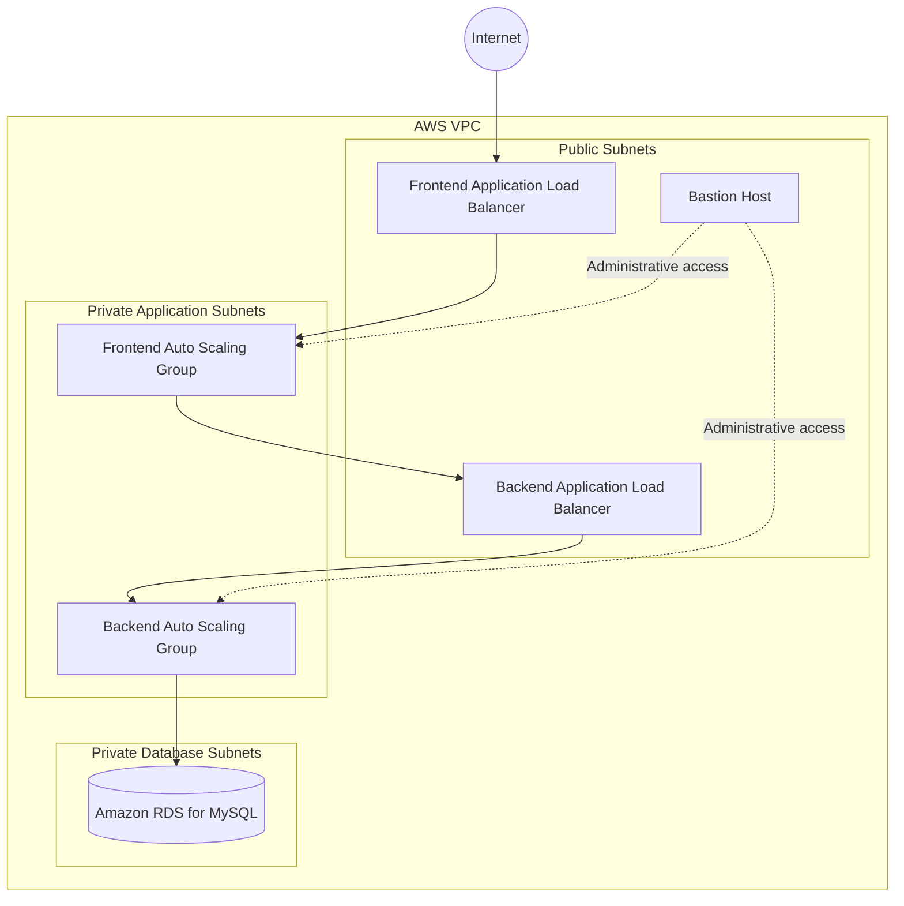

# Modular Three-Tier AWS Infrastructure with Terraform

A modular Infrastructure-as-Code project that provisions the AWS resources for a three-tier application. Terraform modules are used to separate networking, frontend, backend, database, load balancing, and Auto Scaling components.

## Project overview

The configuration includes:

- **Networking:** VPC, public and private subnets across two Availability Zones, route tables, Internet Gateway, and NAT Gateway.
- **Traffic management:** Separate Application Load Balancers for the frontend and backend.
- **Compute:** Frontend and backend EC2 launch templates and Auto Scaling Groups.
- **Database:** A private Amazon RDS for MySQL instance and DB subnet group.
- **Administration:** A bastion host for controlled administrative access.
- **Environments:** Separate Terraform entry points for `dev`, `test`, and `prod`.

## Architecture



> The diagram is a high-level view of the intended traffic flow. Actual access depends on the deployed security-group rules and application configuration.

## Repository structure

```text
Module-Three-Tier-Terraform-Project/
├── README.md
├── Screenshots/
└── Module-Three-Tier-Terraform-Project/
    ├── .gitignore
    └── ROOT/
        ├── envs/
        │   ├── dev/
        │   ├── test/
        │   └── prod/
        └── modules/
            ├── infrastructure/
            ├── bastion/
            ├── frontend/
            │   ├── ec2/
            │   ├── launch-template/
            │   ├── loadbalancer-frontend/
            │   └── asg/
            ├── backend/
            │   ├── ec2/
            │   ├── launch-template/
            │   ├── loadbalancer-backend/
            │   └── asg/
            └── database/
```

## Getting started

### Prerequisites

- Terraform installed
- AWS CLI installed and configured with an AWS account/profile
- AWS permissions to create the resources defined in the modules
- Required key pair and application configuration

### Initialize and review the environment

From the environment you intend to deploy, for example `dev`:

```bash
cd Module-Three-Tier-Terraform-Project/ROOT/envs/dev
terraform init
terraform fmt -recursive
terraform validate
terraform plan
```

Review the plan carefully before applying. If you are using the staged deployment workflow below, run each command from the same environment directory.

### Staged apply workflow

The project’s staged workflow creates the base networking and shared resources first, followed by compute launch templates and Auto Scaling Groups:

```bash
terraform apply -target=module.vpc
terraform apply -target=module.bastion
terraform apply -target=module.frontend-ec2
terraform apply -target=module.backend-ec2
terraform apply -target=module.frontend_alb
terraform apply -target=module.backend_alb
terraform apply -target=module.rds

terraform apply -target=module.frontend_launchtemplate
terraform apply -target=module.backend_launchtemplate
terraform apply -target=module.asg-backend
terraform apply -target=module.asg-frontend
```

Targeted applies are useful for staged troubleshooting/bootstrap work, but they do not replace reviewing a complete plan. After configuration is complete, run `terraform plan` and review all proposed changes before your normal apply.

### Application configuration

1. Configure the frontend to use the backend load balancer URL.
2. Configure the backend with the RDS endpoint and database settings using a secure secret/configuration mechanism.
3. Deploy the frontend and backend application code to the appropriate compute tier.
4. Verify the frontend, backend API, load balancer target health, and database connectivity.

## Screenshots

The `Screenshots/` folder is reserved for evidence from the actual deployment. Upload your project screenshots there, then embed each image below using its repository-relative path.

Suggested screenshots and filenames:

| Filename | What to capture |
| --- | --- |
| `architecture.png` | Final AWS architecture diagram |
| `vpc-subnets.png` | VPC, Availability Zones, and subnet layout |
| `load-balancers.png` | Frontend/backend ALBs and target-group health |
| `auto-scaling-groups.png` | Frontend/backend Auto Scaling Groups and instances |
| `rds-database.png` | RDS instance status and database configuration (hide sensitive details) |
| `terraform-apply.png` | Successful Terraform apply output |
| `application-running.png` | Working application in the browser |

Once those files are committed, embed them in this section with Markdown, for example:

```markdown

```

**Before sharing screenshots publicly:** hide passwords, access keys, session tokens, private IPs where appropriate, and any other sensitive account or connection details.

## Security notes

- Never commit database passwords, access keys, private keys, or `terraform.tfstate` files.
- Supply sensitive values through secure variables or a secrets manager instead of hard-coding them in Terraform configuration.
- Restrict SSH ingress to trusted IP addresses rather than opening it to the entire internet.
- Review the AWS resources and expected costs before deploying. Delete resources when they are no longer needed.

## Technologies

**AWS · Terraform · HCL · EC2 · VPC · Application Load Balancer · Auto Scaling · Amazon RDS (MySQL)**
